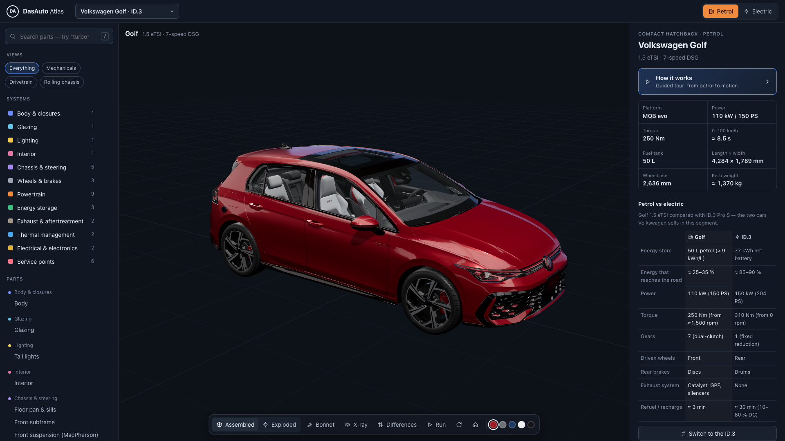
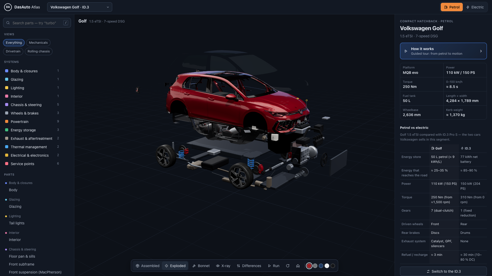
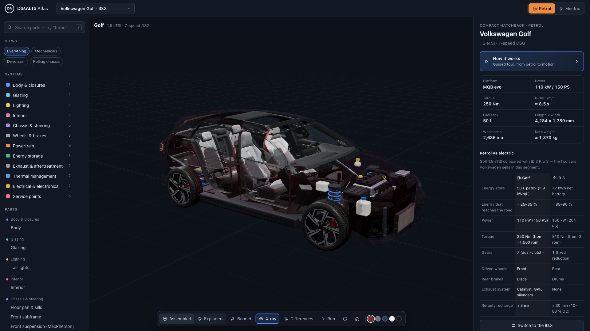
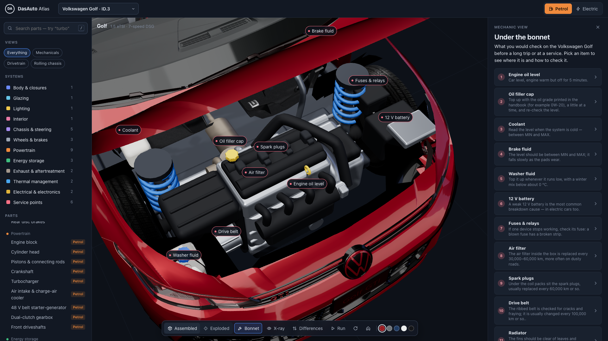
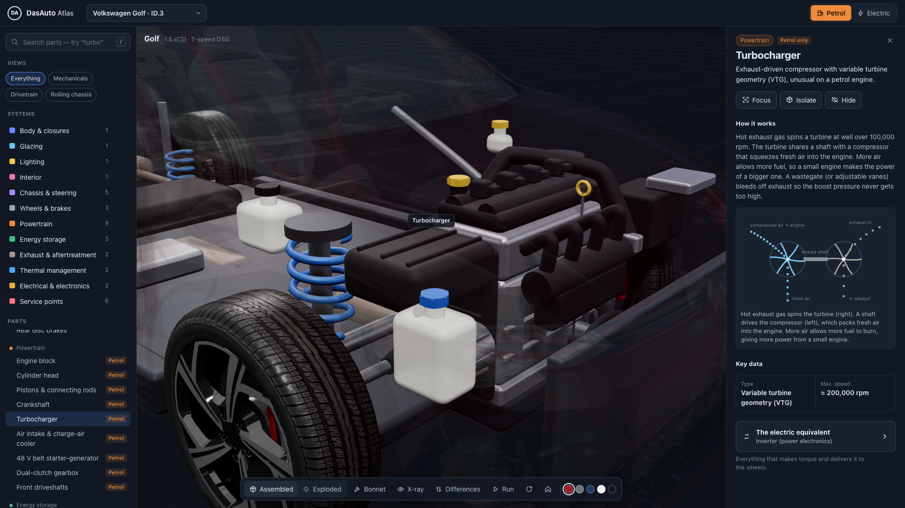
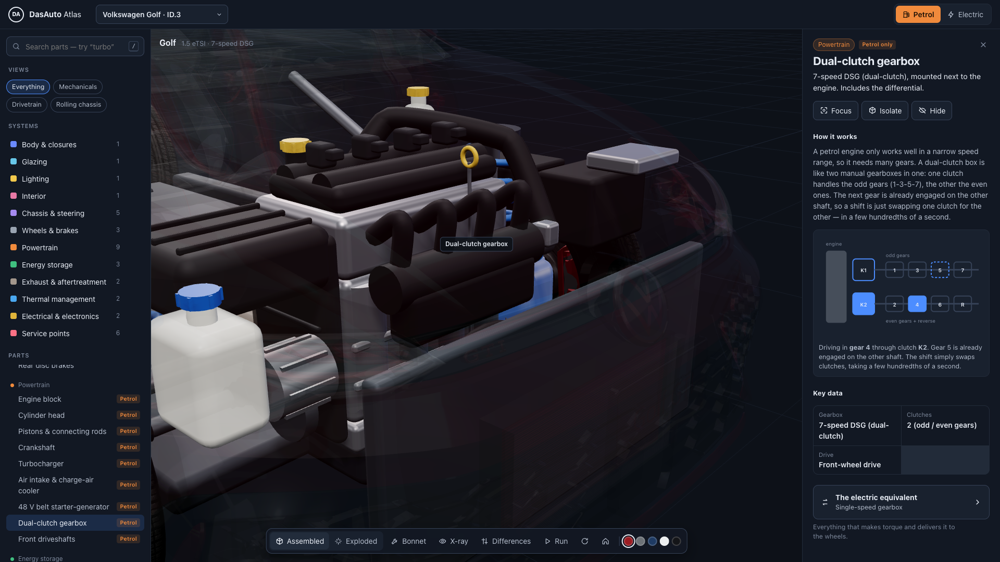
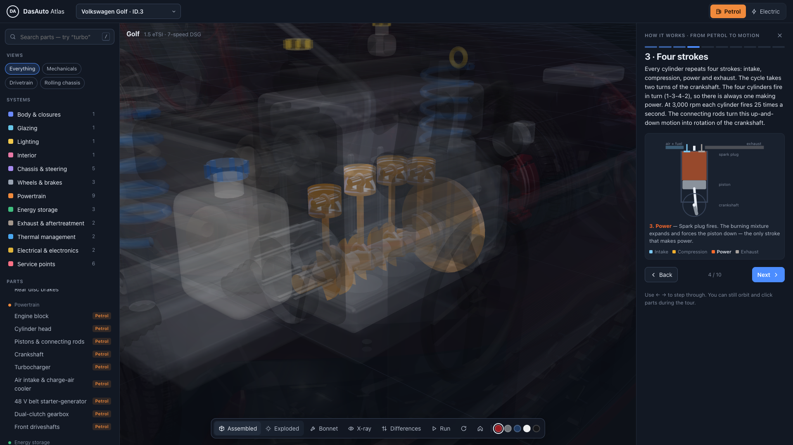
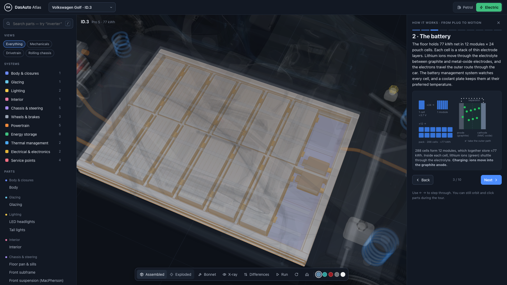

# DasAuto Atlas

An interactive 3D atlas of real cars, made to explain how they work. It is inspired by
[Human Atlas](https://github.com/ashemag/human-atlas). Each petrol car is paired with its maker's electric
counterpart, and every car is a real 3D model:

| Brand | Petrol | Electric |
| --- | --- | --- |
| Volkswagen | Golf 1.5 eTSI | ID.3 Pro S |
| Volkswagen | Tiguan 1.5 eTSI | ID.4 Pro |
| Volkswagen | Passat Pro 1.5 TSI | ID.7 Pro |
| BMW | 330i | i4 eDrive40 |
| Mercedes-Benz | C 200 | EQE 350+ |
| Audi | Q5 45 TFSI quattro | Q4 e-tron 40 |
| Fiat | 500 1.0 Hybrid | 500e |
| MINI | Cooper S | Cooper SE |
| Hyundai | Kona 1.6 T-GDi | Kona Electric |

## Screenshots

| | |
| --- | --- |
|  |  |
| Real Volkswagen Golf model | Exploded view |
|  |  |
| X-ray: the machinery inside | Mechanic view: under the bonnet |
|  |  |
| Click a part to see how it works | Dual-clutch gearbox |
|  |  |
| Guided tour: four strokes | ID.3: the battery pack |

A demo video is attached to each [GitHub release](https://github.com/amirrezaalasti/DasAuto/releases).

## What you can do

- **Explore**: orbit, zoom and click any of ~45 parts per car. Each part says *what it is* and *how it works*, with key data.
- **The machinery follows each car's real layout**: transverse or lengthways engine, three or four cylinders,
  turbo or not, dual-clutch, automatic or manual gearbox, mild-hybrid type, front-, rear- or all-wheel drive, and
  front or rear electric motor. The explanations and tours adapt to match.
- **How it works tours**: a guided tour of up to 10 steps per drivetrain ("from petrol to motion" or "from plug to motion"). The camera
  flies to each component, other parts fade, and animated energy flows show fuel, air, exhaust, coolant, torque,
  high-voltage DC/AC, charging current and regeneration.
- **Animated explainers**: four-stroke cycle, turbocharger, DSG dual clutch, rotating magnetic field of the electric motor,
  battery cells → modules → pack, AC vs DC charging, regenerative braking, brakes and the heat pump.
- **Run mode** (Space): the wheels turn, pistons fire in order 1-3-4-2, the crank and motor rotor spin, and energy flows.
- **Mechanic view** (B): the bonnet swings open over the real engine bay, with pins on everything you check: oil
  level and filler, coolant, brake fluid, washer fluid, 12 V battery, fuses, air filter, spark plugs and drive
  belt. Electric cars get their own list, starting with the high-voltage cables you must never touch. Each item
  says what it does and how a mechanic checks it.
- **Exploded view** (E), **X-ray** (X), **Differences** (D): the last one highlights the parts that only exist because the car is petrol or electric.
- **Petrol vs electric**: a side-by-side comparison, plus "the electric equivalent" links. For example, the fuel tank leads to the battery and the gearbox to the reduction gear.
- System layers and presets, search (`/`), isolate, hide, paint colours, and shareable URLs (`#model=compact&drive=ev&part=inverter`).
- Works on phones: the parts list becomes a drawer and the details panel a bottom sheet.

## Run it

```bash
npm install
npm run dev      # http://localhost:3016
npm run build    # type-check + production build into dist/
```

## Real 3D models

The body, glass, lights, interior and wheels come from real 3D models in `public/models/<id>.glb`. The engine,
motor, battery, service points and the rest of the machinery are detailed reconstructions inside them, so x-ray,
exploded view, the tours and the mechanic view all work. Only cars with real models of both versions are listed
(`src/data/available.json`, written by the download script).

The models come from Sketchfab, and downloading needs a free account's API token
(<https://sketchfab.com/settings/password>):

```bash
echo "SKETCHFAB_TOKEN=your-token" > .env.local   # git-ignored; SK_API_KEY also works
npm run models            # every car in src/data/models.json, or: npm run models -- golf id3
```

To add a car:

1. Add its data to `src/data/vehicles.ts`.
2. Add its Sketchfab model to `src/data/models.json`.
3. Run `npm run models -- <id>`.

The loader in `src/atlas/realModel.ts` does the following:

- turns the nose to +x and scales the model so its wheelbase matches the real car;
- sorts meshes into atlas parts by name, material, position and shape;
- finds the bonnet line for the mechanic view.

If a car ends up facing backwards, set `"flip": true` for it in `models.json`. Add `?debug` to the URL to log how
each mesh was classified.

The credits for every model are in `src/data/models.json`, and the app shows them under each car. Several are
licensed **CC BY-NC-SA 4.0**: the Passat Pro, Audi Q5, Fiat 500, and both Hyundai Konas. While they are included,
the project must stay non-commercial and be shared under the same terms.

## How it is built

React + TypeScript + Vite, with three.js via @react-three/fiber and drei.

- `src/atlas/buildCar.ts` builds every car from its real dimensions (length, width, height, wheelbase,
  overhangs, tyre size). It produces the machinery: block, head, pistons, crankshaft, turbo, DSG, motor,
  inverter, battery modules and more. It also produces a schematic body for cars without a real model, the
  energy-flow paths and the part animations.
- `src/atlas/realModel.ts` loads a real model and puts it in the same coordinate frame.
- `src/data/vehicles.ts` holds the models and specs; `content.ts` the part explanations; `tours.ts` the guided tours.
- `src/components/Diagrams.tsx` contains the animated SVG explainers.

Figures are representative and rounded, and vary by trim, market and model year. The machinery is a
reconstruction for learning, not factory CAD data. Not affiliated with Volkswagen AG.
